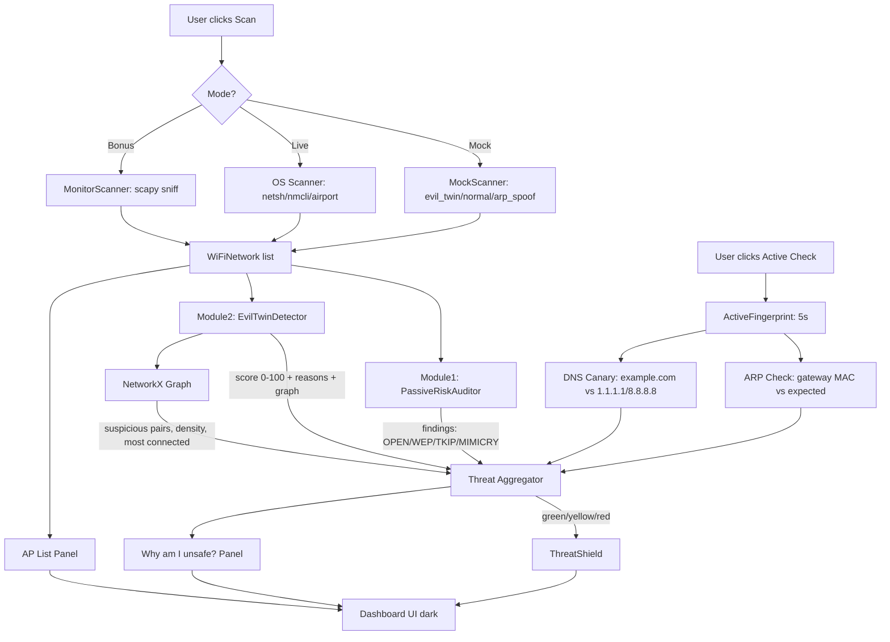

# Data Flow Diagram

## High-Level Flow (Mermaid — paste into mermaid.live or GitHub)


## ASCII Fallback
```
                  +-------------------+
                  |   User: Scan      |
                  +--------+----------+
                           |
               +-----------+-----------+
               |           |           |
           Mock/Scenario  OS API   Monitor(optional)
               |           |           |
               +-----------+-----------+
                           |
                    WiFiNetwork[] (SSID,BSSID,signal,channel,encryption,vendor)
                           |
        +------------------+------------------+
        |                  |                  |
   Module1           Module2            Module3 (on demand ~5s)
  RiskAudit       EvilTwin+Graph      ARP + DNS Canary
        |                  |                  |
        +------------------+------------------+
                           |
                    Threat Level (G/Y/R) + reasons
                           |
        +------------------+------------------+
        |                  |                  |
     Shield            AP List         Why unsafe? Panel
        |                  |                  |
        +------------------+------------------+
                           |
                     Dashboard (CustomTkinter)
```

## Step-by-Step Example (Evil Twin Scenario)
1. **Scan**: Mock returns 8 APs — 6 legit + 2 evil (CoffeeShop_Free duplicated).
2. **Module1**: Flags Library_Open (Open), OldRouter_WEP (WEP), Campus_WiFi mimicry (vendor mismatch).
3. **Module2**: Groups by SSID → CoffeeShop_Free has 2 BSSIDs, different vendor (Cisco vs Unknown), encryption mismatch (WPA2 vs Open), channel spread 6→11, signal jump -42→-28 → score 30+25+20+15+10 = 100 → level `evil_twin_likely` → RED.
4. **Graph**: NetworkX builds 8 nodes, 2 suspicious edges (CoffeeShop_Free pair, Campus_WiFi pair), density 0.07, most_connected = evil BSSID.
5. **Module3** (on Active Check): ARP shows gateway with 2 MACs (DE:AD:BE... + 00:1A:2B...), DNS shows example.com → 192.168.1.100 vs trusted 93.184.216.34 → hijack → RED.

## Data Types
- WiFiNetwork dataclass: ssid, bssid, signal_dbm, channel, frequency, encryption, cipher, auth, vendor.
- RiskFinding: network, risk, severity, message, score.
- SuspicionResult: ssid, score, level, reasons[], related_bssids, graph_insights.
- ARPCheckResult: gateway_ip, gateway_mac, vendor, all_macs, is_spoof_suspected, reasons.
- CanaryDNSResult: per-domain system_ips vs trusted_ips, is_hijack_suspected.
